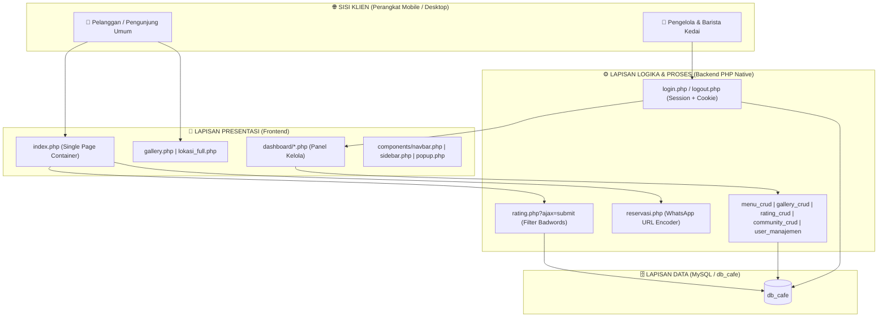
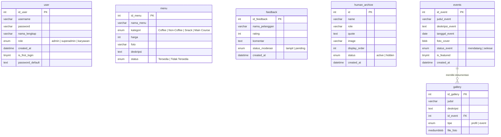

# Sistem Manajemen Toko Kopi Berbasis Website - Toko Kopi Woelandari

<div align="center">


[](https://www.php.net/)
[](https://www.mysql.com/)
[](https://laragon.org/)
[](assets/css/)
[]()

<p align="center">
  <b>Sistem Informasi Manajemen & Company Profile Interaktif dengan Reservasi WhatsApp Terintegrasi, Katalog Menu Dinamis, dan Dashboard Backoffice Multi-Level Role.</b>
</p>

</div>

---

## 📑 Daftar Isi

- [📌 Sekilas Proyek](#-sekilas-proyek)
- [🎯 Permasalahan & Kebutuhan Operasional](#-permasalahan--kebutuhan-operasional)
- [💡 Solusi Sistem](#-solusi-sistem)
- [✨ Fitur-Fitur Utama Sistem](#-fitur-fitur-utama-sistem)
  - [1. Modul Publik (Customer-Facing)](#1-modul-publik-customer-facing)
  - [2. Modul Backoffice (Admin & Karyawan)](#2-modul-backoffice-admin--karyawan)
- [🎨 Konsep Desain & Karakteristik UI/UX](#-konsep-desain--karakteristik-uiux)
- [🏗️ Arsitektur Sistem & Alur Data](#️-arsitektur-sistem--alur-data)
- [🗄️ Struktur Basis Data (Entity Relationship)](#️-struktur-basis-data-entity-relationship)
- [📂 Struktur Direktori Proyek](#-struktur-direktori-proyek)
- [🚀 Panduan Instalasi & Menjalankan Sistem](#-panduan-instalasi--menjalankan-sistem)
- [🔑 Akun Bawaan (Default Credentials)](#-akun-bawaan-default-credentials)

---

## 📌 Sekilas Proyek

**Woelandari Coffee** adalah platform web terpadu yang memadukan _Company Profile_ interaktif dengan _Sistem Manajemen Operasional Kafe_ (Backoffice). Sistem ini dirancang untuk mendigitalisasi operasional harian kedai kopi, memperluas jangkauan promosi, serta mempermudah pelanggan dalam mengakses informasi dan melakukan reservasi meja.

Aplikasi ini mengombinasikan:

1. **Landing Page Interaktif (Single Page Experience):** Menampilkan profil kafe, filosofi racikan kopi, katalog menu interaktif dengan panel spesifikasi produk, galeri arsip visual, profil barista/kru (_human archive_), dan ulasan pelanggan.
2. **Sistem Reservasi Meja Instan:** Formulir reservasi tervalidasi lengkap (jam kunjungan, durasi pemesanan, jumlah tamu, pilihan area indoor/outdoor) yang langsung terhubung ke WhatsApp pengelola dengan template pesan terstandarisasi.
3. **Panel Administrasi Backoffice Terstruktur:** Dilengkapi sistem _Role-Based Access Control_ (RBAC) bagi tingkatan `superadmin`, `admin`, dan `karyawan` untuk mengelola data menu & stok dapur, arsip foto & agenda event, moderasi ulasan publik, serta pengelolaan akun staf.

---

## 🎯 Permasalahan & Kebutuhan Operasional

Dalam proses bisnis kedai kopi konvensional, terdapat beberapa kendala operasional yang sering ditemui:

1. **Penyampaian Informasi Menu & Stok Tersebar:**  
   Informasi daftar menu, ketersediaan produk di dapur, harga, dan jam operasional kerap berubah atau ditanyakan berulang kali oleh pelanggan melalui percakapan pesan instan.
2. **Pencatatan Reservasi Manual yang Rawan Bentrok:**  
   Reservasi tempat tanpa formulir terpusat sering menimbulkan pencatatan ganda (_double booking_), ketidaksesuaian durasi waktu, serta ketiadaan panduan protokol kedatangan bagi pengunjung.
3. **Pengelolaan Arsip, Kegiatan, & Reputasi:**  
   Dokumentasi kegiatan kedai, agenda event komunitas, perkenalan tim barista, serta testimoni kepuasan pelanggan belum terdokumentasi dalam satu sistem resmi yang terpusat dan dapat dimoderasi.

---

## 💡 Solusi Sistem

Untuk menjawab kebutuhan di atas, sistem ini menyediakan solusi menyeluruh:

- 📱 **Sistem Reservasi Meja Terstruktur:** Formulir input tervalidasi yang langsung menyusun rincian pemesanan ke format pesan WhatsApp terenkode secara otomatis, dilengkapi panduan durasi dan batas toleransi kedatangan 15 menit.
- 📋 **Katalog Menu Digital Dinamis:** Pengunjung dapat mencari dan memfilter produk per kategori (_Coffee, Non-Coffee, Snack, Main Course_), dengan kartu preview interaktif di sisi kiri layar.
- ⭐ **Sistem Ulasan Publik Terproteksi:** Fitur rating bintang dan ulasan komentar dengan penyaring kata kasar (_badwords filter_) serta sistem moderasi status (`tampil` vs `pending`) di panel admin.
- 🖼️ **Galeri Visual & Agenda Event:** Dokumentasi arsip foto kedai dan publikasi jadwal kegiatan mendatang (_upcoming events_) serta arsip event selesai.
- 👥 **Human Archive (Profil Tim Kedai):** Komponen slider foto monokrom personil kedai dengan kutipan personal dan urutan tampilan (_display order_) yang dapat diatur admin.
- 🔐 **Backoffice Multi-Role:** Panel dashboard aman dengan otentikasi session dan remember me (cookie 7 hari), pemisahan hak akses antara staf lapangan dan pimpinan pengelola.

---

## ✨ Fitur-Fitur Utama Sistem

### 1. Modul Publik (Customer-Facing)

- **Landing Page Terpadu (`index.php`):**
  - **Beranda (`home.php`):** Tampilan welcoming interaktif dengan animasi karakter kopi yang merespons pergerakan kursor mouse pengunjung (_interactive mousemove glow & parallax_).
  - **Tentang Kami (`about.php`):** Narasi sejarah berdirinya kafe, filosofi racikan kopi, visi-misi F&B, dan bagan tata kelola kedai.
  - **Katalog Menu (`menu.php`):** Filter 4 kategori kuliner, sistem _pagination_ (8 item/halaman), bilah pencarian instan, dan panel pratinjau detail produk di sisi kiri (harga, foto, status kesiapan dapur, dan karakteristik rasa).
  - **Profil Tim Komunitas (`community.php`):** Galeri horizontal bertema potret monokrom memperkenalkan jajaran barista dan kru lengkap dengan peran dan kutipan.
  - **Form Reservasi (`reservasi.php`):** Form pemesanan meja (Nama, WhatsApp, Tanggal, Jam, Durasi, Pilihan Area Indoor/Outdoor, Pax) yang langsung men-generate link WhatsApp resmi kedai. Dilengkapi informasi batas waktu 120 menit, batas order jam 21:00 WIB, dan toleransi kedatangan 15 menit.
  - **Rating & Testimoni Publik (`rating.php`):** Statistik ringkasan nilai rata-rata, grafik batang distribusi kepuasan, filter ulasan berdasarkan jumlah bintang, form kirim review via AJAX, dan filter kata-kata kasar otomatis.
  - **Informasi Lokasi & Kontak (`lokasi.php` & `lokasi_full.php`):** Titik alamat presisi terhubung dengan navigasi Google Maps, jam operasional, tautan media sosial, dan kontak pengelola.
  - **Arsip Visual & Agenda (`gallery.php`):** Halaman arsip galeri foto kedai dan daftar agenda event komunal dengan tab filter terpisah.

### 2. Modul Backoffice (Admin & Karyawan)

- **Gerbang Autentikasi (`login.php`):**
  - Desain form bergaya _paper-stack nota_ dengan status indikator (_STANDBY_).
  - Dilengkapi fitur _Remember Me_ berbasis cookie aman 7 hari dan enkripsi `password_verify` BCRYPT.
- **Dashboard Ringkasan Operasional (`dashboard/dashboard.php`):**
  - 4 metrik kartu data utama: total menu aktif, agenda mendatang, total ulasan masuk, dan personil tim.
  - Baris riwayat log aktivitas terbaru secara kronologis.
- **Manajemen Menu (`dashboard/menu_crud.php`):**
  - Operasi CRUD penuh: tambah menu baru, ubah rincian harga/deskripsi, saklar toggle ketersediaan dapur (_Tersedia / Habis_), dan hapus item.
  - Terintegrasi _client-side crop image_ (canvas HTML5) untuk standardisasi rasio foto produk.
- **Manajemen Galeri & Event (`dashboard/gallery_crud.php`):**
  - Tabulasi terpisah pengarsipan foto umum (_Gallery_) dan dokumentasi agenda (_Events_).
  - Penyematan status event unggulan (_featured event_).
- **Moderasi Ulasan / Feedback (`dashboard/rating_crud.php`):**
  - Rangkuman metrik ulasan masuk, rata-rata rating, antrean moderasi, dan status publikasi.
  - Aksi persetujuan tayang (_approve/tampil_), penahanan (_pending/reject_), dan penghapusan ulasan yang tidak layak.
- **Manajemen Tim / Komunitas (`dashboard/community_crud.php`):**
  - Pendaftaran potret personil baru, penetapan jabatan, kalimat kutipan personal, dan fitur penguncian urutan tampilan visual (_display order_).
- **Manajemen Pengguna (`dashboard/user_manajemen.php`):**
  - Hak akses eksklusif bagi `superadmin` dan `admin` untuk mengelola akun sistem, memilih peran level jabatan, serta mengatur ulang kata sandi.
- **Pengaturan Profil Karyawan (`dashboard/akun_staff.php`):**
  - Fasilitas mandiri bagi akun bertipe `karyawan` untuk memperbarui username, nama lengkap, dan mengganti kata sandi operasional secara mandiri.

---

## 🎨 Konsep Desain & Karakteristik UI/UX

Aplikasi ini menerapkan konsep visual **Vintage Blueprint / Retro Paper Craft Laboratory**:

- **Skema Warna Karakteristik:**
  - _Blueprint Navy:_ `#002B5B` (warna garis struktur dan kontras utama).
  - _Laboratory Red:_ `#EA4335` (aksen lakban/tape penanda dan tombol aksi penting).
  - _Paper Cream / White:_ `#F8F9FA` & `#EDE8DC` (kertas nota catatan).
  - _Grid Lines:_ Garis-garis kotak blueprint ukuran `30px 30px` pada latar belakang layar.
- **Tipografi Khusus:**
  - `Courier Prime`: Memberikan kesan dokumen mesin ketik laboratorium.
  - `Special Elite`: Tampilan stempel dan judul bergaya retro vintage.
  - `Caveat`: Aksen coretan tulisan tangan personal pada catatan.
  - `Montserrat`: Teks antarmuka navigasi modern yang mudah dibaca.
- **Cache Busting Otomatis:**
  - Penggunaan fungsi PHP `filemtime()` pada seluruh _stylesheet link_ memastikan klien selalu memuat CSS versi paling mutakhir tanpa terkendala cache browser.

---

## 🏗️ Arsitektur Sistem & Alur Data

### 1. Arsitektur Komponen



### 2. Matriks Hak Akses Pengguna (RBAC)

| Modul / Menu                             | Pengunjung Publik | Karyawan (`karyawan`) | Admin (`admin`) | Superadmin (`superadmin`) |
| ---------------------------------------- | :---------------: | :-------------------: | :-------------: | :-----------------------: |
| **Lihat Profil, Menu, Galeri, Lokasi**   |        ✅         |          ✅           |       ✅        |            ✅             |
| **Kirim Reservasi WhatsApp**             |        ✅         |          ✅           |       ✅        |            ✅             |
| **Beri Rating & Review**                 |        ✅         |          ✅           |       ✅        |            ✅             |
| **Akses Dashboard Ringkasan**            |        ❌         |          ✅           |       ✅        |            ✅             |
| **Kelola Data Menu & Stok**              |        ❌         |          ✅           |       ✅        |            ✅             |
| **Kelola Galeri & Agenda Event**         |        ❌         |          ✅           |       ✅        |            ✅             |
| **Moderasi Rating / Feedback**           |        ❌         |          ✅           |       ✅        |            ✅             |
| **Kelola Data Tim Komunitas**            |        ❌         |          ✅           |       ✅        |            ✅             |
| **Ubah Profil & Sandi Pribadi**          |        ❌         | ✅ (`akun_staff.php`) |       ✅        |            ✅             |
| **Manajemen Pengguna (User Management)** |        ❌         |          ❌           |       ✅        |            ✅             |

---

## 🗄️ Struktur Basis Data (Entity Relationship)

Database menggunakan nama **`db_cafe`** dengan 6 tabel relasional dan operasional utama:



### Rincian Kamus Data Singkat

1. **`user`**: Menyimpan kredensial otorisasi sistem, hash password (BCRYPT), status pergantian sandi pertama (_first login_), dan role akun.
2. **`menu`**: Menyimpan katalog kuliner kafe dengan status kesiapan dapur, harga, foto, dan kategori.
3. **`feedback`**: Menampung testimoni pengunjung, skor bintang (1-5), komentar yang lolos sensor, dan status moderasi admin.
4. **`human_archive`**: Arsip profil para personil kedai yang tampil pada slider menu komunal.
5. **`events`**: Agenda kegiatan kedai yang dipisahkan antara agenda mendatang (_upcoming_) dan agenda selesai.
6. **`gallery`**: Berkas foto resolusi web yang dapat berdiri sendiri sebagai profil kedai atau berelasi khusus ke entitas `events`.

---

## 📂 Struktur Direktori Proyek

```text
woelandari_coffeshop/
├── .vscode/                       # Pengaturan workspace IDE & konfigurasi SFTP
├── assets/
│   ├── css/                       # Stylesheet modular bertema retro blueprint
│   │   ├── dashboard/             # Stylesheet khusus tampilan panel backoffice
│   │   ├── about_style.css        # Gaya section profil & visi-misi
│   │   ├── community_style.css    # Gaya kartu tim & custom horizontal slider
│   │   ├── gallery_style.css      # Gaya galeri foto & agenda event
│   │   ├── home_style.css         # Gaya halaman depan & animasi mousemove
│   │   ├── login_style.css        # Gaya form autentikasi nota kertas
│   │   ├── lokasi_full_style.css  # Gaya detail peta & kontak
│   │   ├── lokasi_style.css       # Gaya section lokasi singkat
│   │   ├── menu_style.css         # Gaya katalog menu & kartu preview produk
│   │   ├── popup_style.css        # Gaya jendela modal interaktif
│   │   ├── rating_style.css       # Gaya ulasan, statistik chart, & form bintang
│   │   └── reservasi_style.css    # Gaya form reservasi meja & protokol kartu
│   ├── images/                    # Aset grafis kedai
│   │   ├── background/            # Gambar latar belakang (hero, canvas, paper)
│   │   ├── community/             # Foto potret personil tim (human archive)
│   │   ├── gallery/               # Berkas arsip foto dokumentasi kafe
│   │   ├── gambar-mentahan/       # Cadangan aset mentah desain
│   │   ├── menu/                  # Foto produk kuliner terkompresi
│   │   └── temp/                  # Direktori pemrosesan sementara
│   └── js/
│       └── responsive.js          # Skrip pendukung hamburger menu & adaptasi mobile
├── components/                    # Komponen modular antarmuka
│   ├── navbar.php                 # Navigasi utama dengan tautan login terselubung
│   ├── popup.php                  # Modal notifikasi sistem & konfirmasi
│   └── sidebar.php                # Panel navigasi samping admin & karyawan
├── config/
│   └── koneksi.php                # Skrip koneksi MySQLi & konfigurasi zona waktu
├── dashboard/                     # Seluruh modul panel pengelola (Backoffice)
│   ├── akun_staff.php             # Modul ganti sandi & nama untuk karyawan
│   ├── community_crud.php         # Kelola susunan dan data tim human archive
│   ├── dashboard.php              # Beranda ringkasan statistik & log harian
│   ├── gallery_crud.php           # Kelola foto galeri & kalender kegiatan
│   ├── menu_crud.php              # Kelola daftar kuliner & saklar stok
│   ├── rating_crud.php            # Moderasi testimoni & ulasan pelanggan
│   └── user_manajemen.php         # Manajemen hak akses akun (Superadmin & Admin)
├── about.php                      # Section publik: Tentang Woelandari & Filosofi
├── community.php                  # Section publik: Kartu personil kedai
├── db_cafe.sql                    # Skrip dump database MySQL lengkap dengan data awal
├── gallery.php                    # Halaman mandiri: Galeri arsip & event kedai
├── home.php                       # Section publik: Tampilan welcoming interaktif
├── index.php                      # Halaman induk publik (Single Page Architecture)
├── login.php                      # Halaman gerbang masuk pengelola (Admin/Karyawan)
├── logout.php                     # Pemutus session & pembersih cookie
├── lokasi.php                     # Section publik: Koordinat & jam operasional
├── lokasi_full.php                # Halaman mandiri: Peta dan kontak detail
├── menu.php                       # Section publik: Eksplorasi menu interaktif
├── rating.php                     # Section publik: Rating, review & AJAX backend
├── reservasi.php                  # Section publik: Formulir reservasi via WhatsApp
├── woelandari.wsd                 # Diagram Use Case berbasis PlantUML
└── woelandari_system_diagram.md   # Dokumentasi arsitektur sistem komprehensif
```

---

## 🚀 Panduan Instalasi & Menjalankan Sistem

### Persyaratan Lingkungan (Prerequisites)

- **Web Server:** Apache (via [Laragon](https://laragon.org/) direkomendasikan, atau [XAMPP](https://www.apachefriends.org/)).
- **PHP Version:** PHP 7.4 atau PHP 8.x (telah diuji pada PHP 8.1 - 8.3).
- **Ekstensi PHP Aktif:** `mysqli`, `session`, `mbstring`, `gd` (untuk pengolahan citra).
- **Database:** MySQL 5.7+ atau MariaDB 10.4+.
- **Web Browser:** Google Chrome, Mozilla Firefox, atau browser modern berbasis Chromium lainnya.

### Langkah-Langkah Instalasi

1. **Unduh atau Clone Repositori:**
   Letakkan berkas proyek ke dalam folder direktori publik web server Anda:
   - **Laragon:** `C:\laragon\www\woelandari_coffeshop`
   - **XAMPP:** `C:\xampp\htdocs\woelandari_coffeshop`

2. **Jalankan Layanan Web Server:**
   Buka Laragon atau XAMPP Control Panel, lalu nyalakan modul **Apache** dan **MySQL**.

3. **Import Basis Data:**
   - Buka peramban web dan akses antarmuka manajemen basis data (misalnya: `http://localhost/phpmyadmin`).
   - Buat database baru bernama **`db_cafe`** dengan _Collation_ `utf8mb4_general_ci`.
   - Pilih tab **Import**, klik **Choose File**, arahkan ke file **`db_cafe.sql`** yang berada di direktori utama proyek, lalu klik **Go / Kirim**.

4. **Konfigurasi Koneksi Database (Jika Diperlukan):**
   Periksa konfigurasi koneksi pada file `config/koneksi.php`:

   ```php
   <?php
   $host     = "localhost";
   $username = "root";
   $password = "";         // Sesuaikan jika MySQL Anda memiliki password
   $database = "db_cafe";

   $conn = mysqli_connect($host, $username, $password, $database);
   ```

5. **Akses Website melalui Peramban:**
   - **Halaman Utama Publik:**  
     👉 [`http://localhost/woelandari_coffeshop/`](http://localhost/woelandari_coffeshop/)
   - **Halaman Login Pengelola:**  
     👉 [`http://localhost/woelandari_coffeshop/login.php`](http://localhost/woelandari_coffeshop/login.php)  
     _(Atau klik logo tersembunyi pada navbar utama)._

---

## 🔑 Akun Bawaan (Default Credentials)

Untuk keperluan pengujian dan demonstrasi fungsional sistem, basis data telah dilengkapi dengan beberapa tingkatan akun operasional:

| Level Jabatan (Role) | Akses Utama     | Keterangan Hak Akses                                                                              |
| -------------------- | --------------- | ------------------------------------------------------------------------------------------------- |
| **Admin**            | Panel Pengelola | Akses penuh dashboard, menu kuliner, galeri foto, moderasi ulasan, tim, & manajemen pengguna      |
| **Karyawan / Staf**  | Panel Pengelola | Akses operasional harian: pantau menu, stok, galeri, moderasi ulasan, & pengaturan profil pribadi |
| **Superadmin**       | Panel Pengelola | Administrator tingkat master untuk pemulihan dan kontrol seluruh sistem                           |

> [!NOTE]  
> Setiap kali akun staf baru didaftarkan melalui modul _User Management_, pengguna baru memiliki penanda `is_first_login = 1` dan diarahkan untuk langsung memperbarui kata sandi default melalui menu **Pengaturan Akun** (`dashboard/akun_staff.php`).

---

<div align="center">

<p><b>☕ Woelandari Coffee - "Berkumpul untuk Berbagi, Berkarya untuk Tumbuh, dan Menciptakan Cerita yang Bermakna."</b></p>

</div>
