# Woelandari Coffee Lab — Diagram Proses Sistem

> Dokumentasi arsitektur dan alur proses sistem website Woelandari Coffee Lab  
> Database: `db_cafe` | Tech Stack: PHP + MySQL + Vanilla JS  
> Dibuat: September 2026

---

## 1. Arsitektur Sistem Keseluruhan

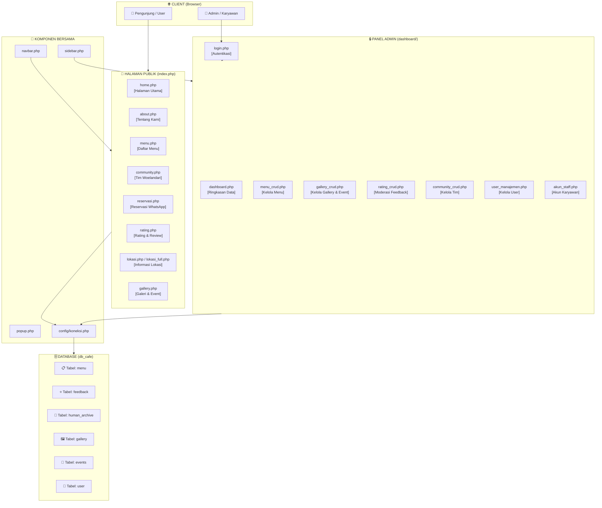

---

## 2. Alur Autentikasi (Login / Logout)

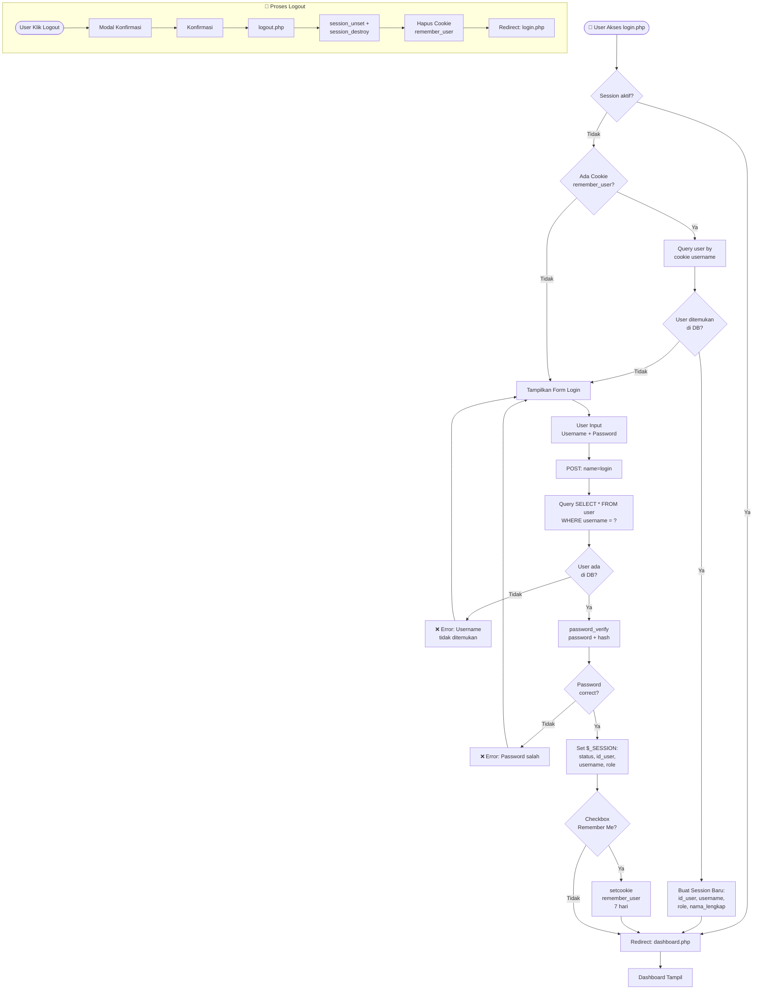

---

## 3. Sistem Role & Hak Akses

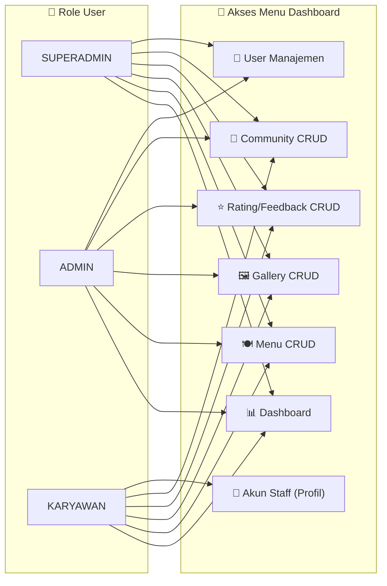

---

## 4. Alur Halaman Publik (Single Page Application)

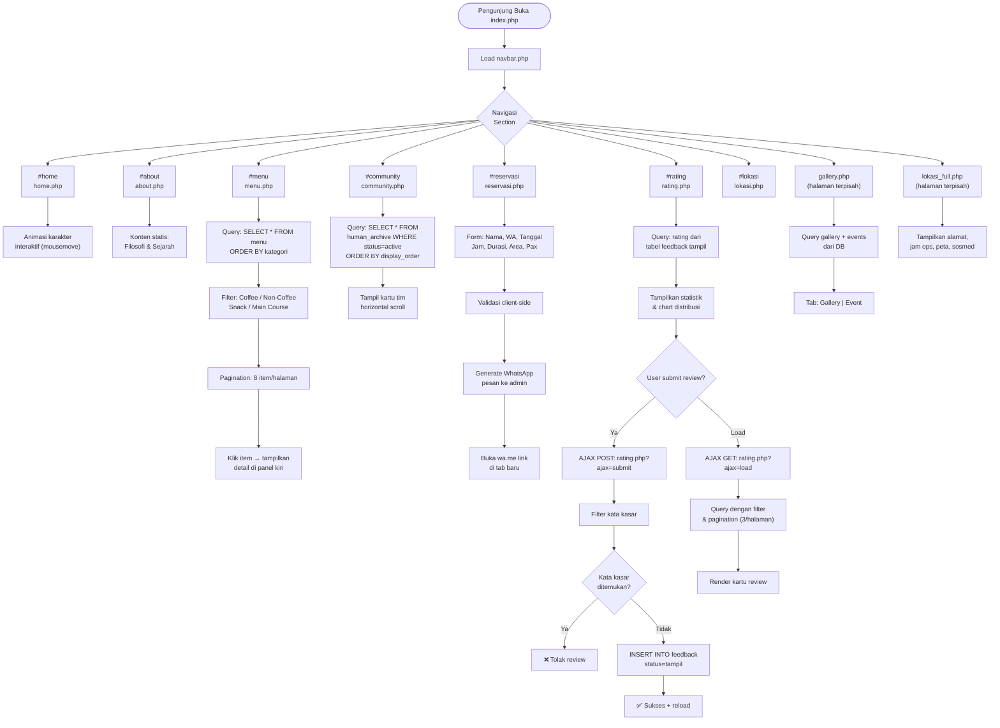

---

## 5. Alur CRUD Menu (Admin)

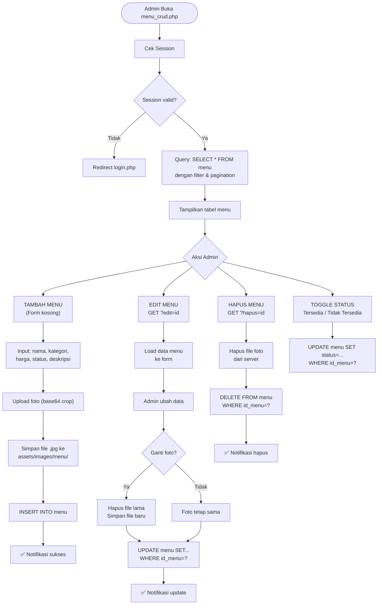

---

## 6. Alur Sistem Rating & Moderasi Feedback

```mermaid
flowchart TD
    subgraph PUBLIK["🌐 Sisi Publik (rating.php)"]
        A1([Pengunjung buka\nhalaman rating]) --> A2["Tampil statistik:\navg rating, chart distribusi"]
        A2 --> A3[Form: Nama + Bintang + Komentar]
        A3 --> A4[User Submit]
        A4 --> A5["AJAX POST ke\nrating.php?ajax=submit"]
        A5 --> A6["Validasi: nama, rating 1-5,\nkomentar tidak kosong"]
        A6 --> A7{Kata kasar\nterdeteksi?}
        A7 -- Ya --> A8[❌ Tolak: Pesan error]
        A7 -- Tidak --> A9["INSERT INTO feedback\n(status_moderasi='tampil')"]
        A9 --> A10[✅ Review tampil langsung]
    end

    subgraph FILTER["🔍 Filter & Pagination"]
        B1([User klik filter bintang]) --> B2["AJAX GET: rating.php?ajax=load\n&filter=N&page=N"]
        B2 --> B3["Query: SELECT dari feedback\nWHERE status=tampil AND rating=N\nLIMIT 3 OFFSET N"]
        B3 --> B4[Render kartu review\ndengan animasi slide-up]
    end

    subgraph ADMIN_MOD["🔒 Moderasi Admin (rating_crud.php)"]
        C1([Admin buka rating_crud]) --> C2["Tampil semua feedback:\ntampil + pending"]
        C2 --> C3{Aksi Moderasi}
        C3 -- Approve --> C4["UPDATE feedback\nSET status='tampil'"]
        C3 -- Reject --> C5["UPDATE feedback\nSET status='pending'"]
        C3 -- Hapus --> C6["DELETE FROM feedback"]
        C4 & C5 & C6 --> C7[✅ Redirect + notifikasi]
    end
```

---

## 7. Alur Manajemen Gallery & Event (Admin)

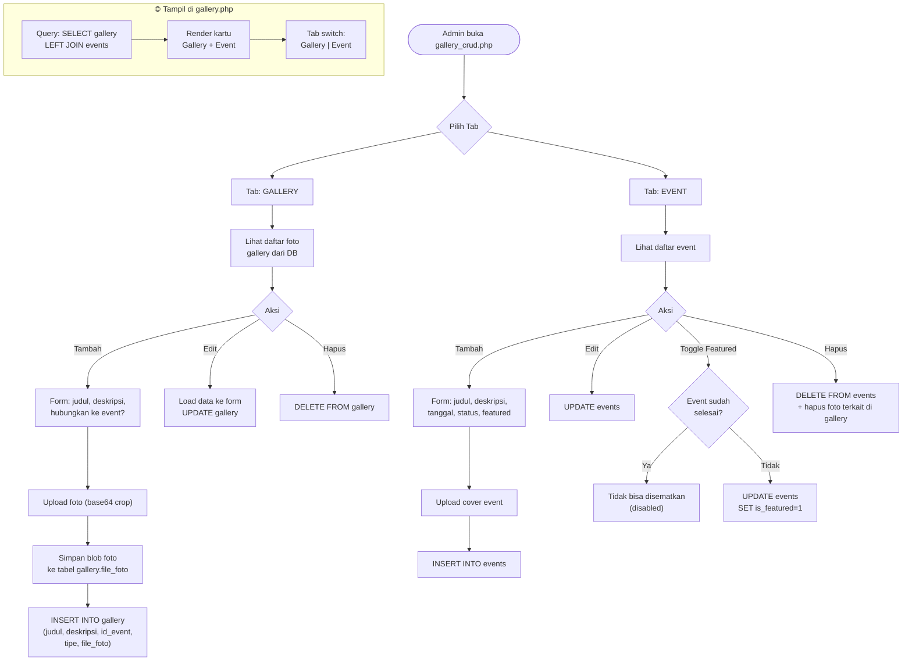

---

## 8. Alur Manajemen User (Admin/Superadmin)

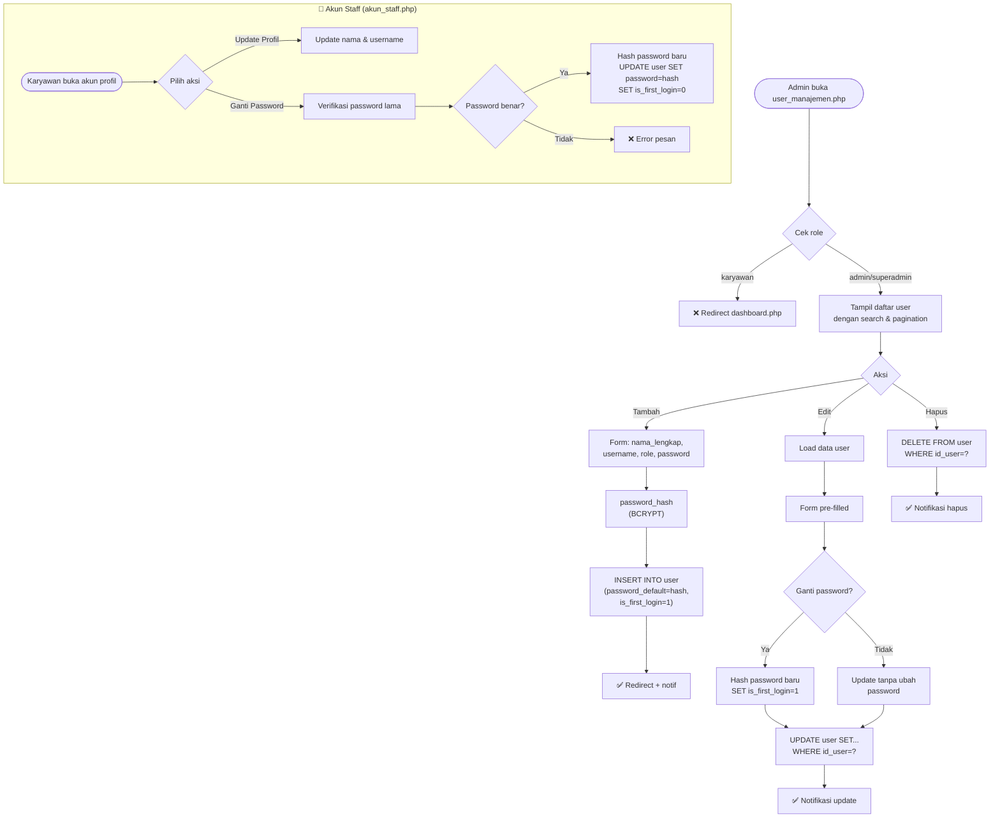

---

## 9. Alur Manajemen Komunitas / Tim (Admin)

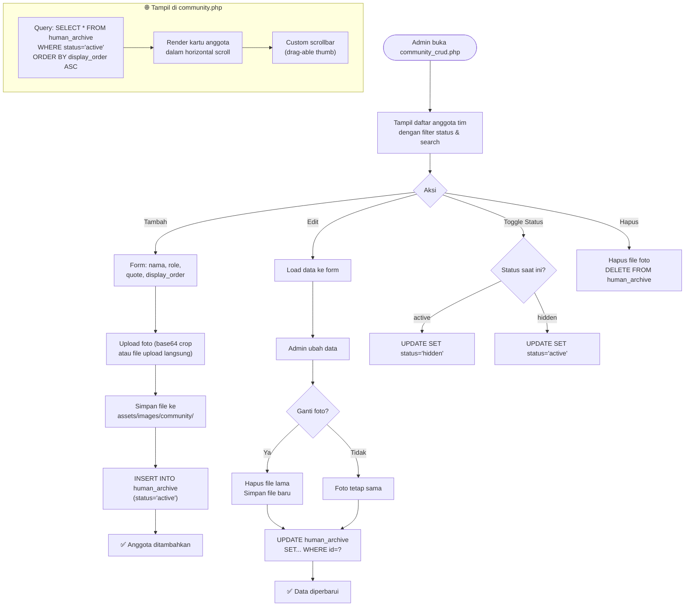

---

## 10. Struktur Database (Entity Relationship)

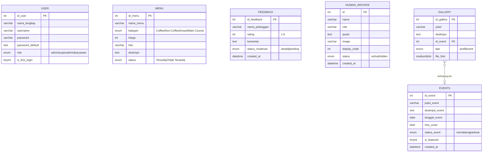

---

## 11. Arsitektur File & Folder

```mermaid
graph TD
    ROOT["📁 woelandari_coffeshop/"]

    ROOT --> IDX["index.php\n[Single Page App Entry]"]
    ROOT --> LGN["login.php\n[Autentikasi]"]
    ROOT --> LGO["logout.php\n[Destroy Session]"]
    ROOT --> GAL["gallery.php\n[Galeri Foto & Event]"]
    ROOT --> LOK["lokasi_full.php\n[Halaman Lokasi Full]"]

    ROOT --> SECTIONS["📄 Section Files"]
    SECTIONS --> s1["home.php"]
    SECTIONS --> s2["about.php"]
    SECTIONS --> s3["menu.php"]
    SECTIONS --> s4["community.php"]
    SECTIONS --> s5["reservasi.php"]
    SECTIONS --> s6["rating.php"]
    SECTIONS --> s7["lokasi.php"]

    ROOT --> COMP["📁 components/"]
    COMP --> c1["navbar.php"]
    COMP --> c2["sidebar.php"]
    COMP --> c3["popup.php"]

    ROOT --> CFG["📁 config/"]
    CFG --> cfg1["koneksi.php\n[DB Connection]"]

    ROOT --> DASH["📁 dashboard/"]
    DASH --> d1["dashboard.php"]
    DASH --> d2["menu_crud.php"]
    DASH --> d3["gallery_crud.php"]
    DASH --> d4["rating_crud.php"]
    DASH --> d5["community_crud.php"]
    DASH --> d6["user_manajemen.php"]
    DASH --> d7["akun_staff.php"]

    ROOT --> ASSETS["📁 assets/"]
    ASSETS --> CSS["📁 css/"]
    ASSETS --> JS["📁 js/\nresponsive.js"]
    ASSETS --> IMG["📁 images/"]
    IMG --> im1["📁 menu/"]
    IMG --> im2["📁 community/"]
    IMG --> im3["📁 gallery/"]
    IMG --> im4["📁 background/"]
    IMG --> im5["📁 gambar-mentahan/"]
```

---

## 12. Alur Reservasi via WhatsApp

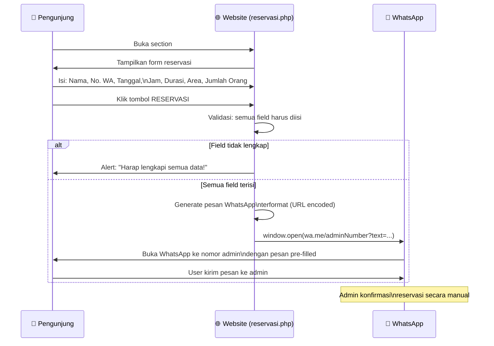

---

## 13. Alur Navigasi Navbar (Publik)

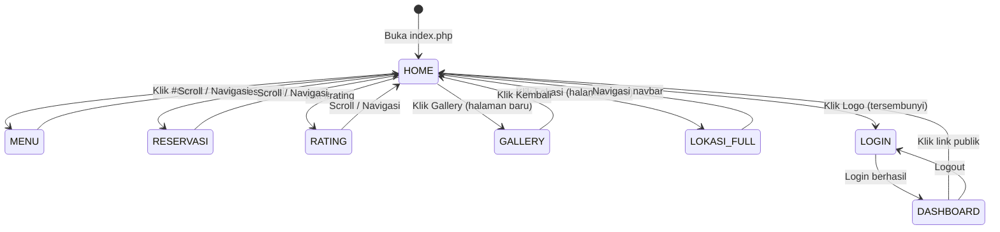

---

## Ringkasan Sistem

| Komponen | Detail |
|---|---|
| **Framework** | PHP Native + MySQL (MySQLi) |
| **Database** | `db_cafe` di localhost |
| **Tabel Utama** | `user`, `menu`, `feedback`, `human_archive`, `gallery`, `events` |
| **Auth** | Session PHP + Cookie (Remember Me 7 hari) |
| **Role** | `superadmin`, `admin`, `karyawan` |
| **Halaman Publik** | Single Page (index.php include section files) |
| **Halaman Terpisah** | `gallery.php`, `lokasi_full.php`, `login.php` |
| **Panel Admin** | `/dashboard/` folder, dilindungi session |
| **Upload Gambar** | Base64 crop (canvas) → file JPG/PNG ke server |
| **Reservasi** | Redirect ke WhatsApp (bukan menyimpan ke DB) |
| **Rating** | AJAX submit + load, filter bintang, moderasi admin |
| **CSS Versioning** | `filemtime()` untuk cache busting |
| **Responsive** | Navbar collapse + sidebar hamburger (mobile) |
